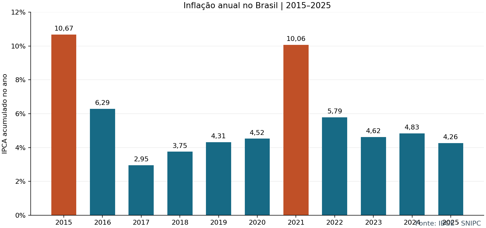

# Inflação no Brasil | IPCA anual de 2015 a 2025

Análise de portfólio em Python e SQL. Quanto os preços medidos pelo IPCA subiram no período e em quais anos a inflação mais acelerou?



## Resultados

- O IPCA atingiu dois dígitos em 2015 (10,67%) e 2021 (10,06%).
- A maior aceleração anual foi de 5,54 pontos percentuais, de 4,52% em 2020 para 10,06% em 2021.
- Em 2025, o IPCA fechou em 4,26%, ante 4,83% em 2024. A queda de 0,57 ponto percentual indica que, em média, os preços medidos pelo índice ainda subiram, porém em ritmo menor.
- O aumento acumulado estimado foi de 82,37%. Uma cesta hipotética de R$ 100 no fim de 2014 chegaria a cerca de R$ 182,37 no fim de 2025 ao acompanhar a variação do índice.

## Dados e método

A base em `ipca_anual.csv` foi transcrita da tabela **Série histórica dos acumulados no ano — IPCA**, na página 17 do [caderno IPCA e INPC de outubro de 2026](https://ftp.ibge.gov.br/Precos_Indices_de_Precos_ao_Consumidor/INPC/Fasciculo_Indicadores_IBGE/ipca-inpc_202610caderno.pdf), publicado pelo IBGE. O recorte contém 11 anos completos. `ano` identifica o ano civil e `ipca_pct` é a taxa acumulada nele, em percentual.

O Python valida a cobertura da série e carrega o CSV no SQLite. O SQL usa `LAG` para calcular a diferença entre taxas consecutivas em pontos percentuais. Em 2015, a diferença fica em branco porque 2014 está fora do recorte. O acumulado multiplica os fatores anuais `(1 + taxa / 100)` e subtrai 1. O resultado é aproximado porque as taxas publicadas foram arredondadas.

A análise é descritiva e usa o índice nacional. A variação percebida por uma família depende de sua cesta de consumo.

## Como reproduzir

Com Python 3.10 ou superior, execute na pasta do projeto:

```bash
python -m pip install -r requirements.txt
python analisar.py
```

O script atualiza o CSV e o PNG na pasta do projeto. O CSV pode ser importado no Power BI. Use o ponto como separador decimal ao configurar a importação.
